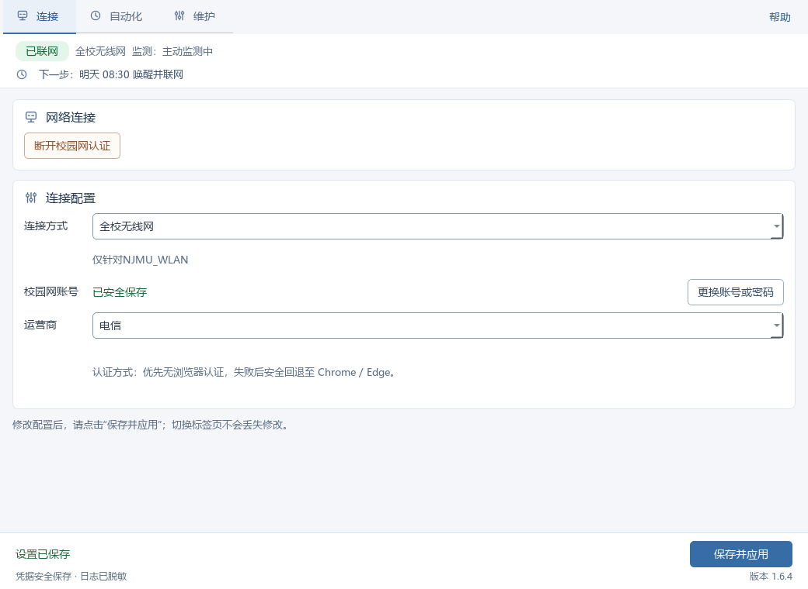

# NJMU 校园网自动化连接程序

面向南京医科大学 Windows 用户的校园网辅助工具：保存账号后自动认证登录、后台保活、
断网自动重连，可选开机联网、定时唤醒、定时休眠。

**最新版本 1.6.4 · Windows 10 / 11 x64 · 非学校官方客户端**

**[⬇ 下载 1.6.4](https://github.com/Mrfei007/njmu-campus-net-assistant/releases/download/v1.6.4/NJMU-CampusNet-Assistant-1.6.4-Windows-x64.zip)** ·
[更新内容](#164-更新内容相对-1592) · [安装步骤](#安装与首次设置)

下载 ZIP 后：完整解压 → 运行 `NJMU校园网自动化连接程序.exe`。不要只复制 EXE，也不要在压缩包内运行。



*1.6.4 连接页：全校无线已联网示例，账号信息不显示。未联网时这里会显示“立即认证并检查联网”；更多运行状态见“维护”页。*

---

## 下载

直接下载：**[NJMU-CampusNet-Assistant-1.6.4-Windows-x64.zip](https://github.com/Mrfei007/njmu-campus-net-assistant/releases/download/v1.6.4/NJMU-CampusNet-Assistant-1.6.4-Windows-x64.zip)**（约 54.2 MB / 51.7 MiB）

也可以打开 [Releases](https://github.com/Mrfei007/njmu-campus-net-assistant/releases) 页，在 **1.6.4** 的 Assets 里下载：

```
NJMU-CampusNet-Assistant-1.6.4-Windows-x64.zip
NJMU-CampusNet-Assistant-1.6.4-Windows-x64.zip.sha256.txt   （可选，仅用于校验）
```

**不要**下载 Assets 里自动生成的 `Source code` 压缩包——那是源码，不能直接运行。

可选：校验下载完整性。在下载目录打开 PowerShell：

```powershell
Get-FileHash .\NJMU-CampusNet-Assistant-1.6.4-Windows-x64.zip -Algorithm SHA256
Get-Content .\NJMU-CampusNet-Assistant-1.6.4-Windows-x64.zip.sha256.txt
```

将输出的 Hash 与 `.sha256.txt` 中的值比较（字母大小写可忽略）；不一致时不要运行，重新下载后再检查。校验用于确认下载完整，不代表程序绝对安全。

> 发布包使用英文文件名，便于下载与校验；解压后的文件夹仍为中文名，不影响使用。

---

## 1.6.4 更新内容（相对 1.5.9.2）

- **断网恢复更快。** 工位有线在后台自动连接/保活正常运行、且未暂停或等待验证时，通常几秒到十几秒发现断网；网线插回、网络就绪后自动重新认证，不需要手动重开程序。实际耗时受电脑、网络和认证服务影响。
- **后台保活更可靠。** 减少后台正常运行却被误判退出的情况，避免不必要的反复断网重连；只有确认后台确实不存在时才尝试重建。
- **工位有线更省心。** 无需安装锐捷客户端；发布包不再附带 Npcap 安装程序，首次使用按 `Npcap下载说明.txt` 从官网下载 1.90 并完成一次验证即可。
- **界面更简洁。** 删除重复的“查看联网详情”按钮，运行状态统一在“维护”页查看；连接、自动化、维护三个标签页的操作方式保持不变。
- **原有功能保留。** 开机自动连接、定时唤醒/休眠、联网后启动本机 UU（用于远程连接）、后台保活、断线自动恢复、账号密码保存在 Windows 凭据管理器等功能均保留。

## 安装与首次设置

1. **解压完整文件夹**到固定位置（例如 `D:\NJMU\1.6.4\`），运行里面的
   `NJMU校园网自动化连接程序.exe`。
   不要只复制 EXE，也不要直接在压缩包里双击运行。
2. 输入校园网**账号、密码**，选择连接方式；网页认证还需要选择**运营商**。
   密码保存在 Windows 凭据管理器里，不写进配置文件。
3. 按需设置自动化功能，点击 **“保存并应用”**，同意管理员授权（用于创建计划任务）。
   设置好之后不需要一直开着主界面。
4. 工位有线还需要两步一次性准备：按 `Npcap下载说明.txt` 从
   https://npcap.com/dist/npcap-1.90.exe 下载并安装 Npcap，
   然后做一次 **“原生认证检查并验证”**——要先断开校园网认证，在离线状态下完成验证。

---

## 三种连接方式

| 模式 | 适用场景 | 首次准备 |
|---|---|---|
| **全校无线** | 教学楼、图书馆等 `NJMU_WLAN` 覆盖区域 | 先用 Windows 手动连接一次 `NJMU_WLAN` 并保存配置；认证默认走无浏览器直连，不兼容时自动回退 Chrome / Edge |
| **宿舍有线** | 宿舍网口 | 接好网线，等 IPv4、网关、DNS 就绪后认证，按提示选运营商 |
| **工位有线** | 工位网口（原生认证） | 安装 Npcap，并完成一次"原生认证检查并验证"；**不需要**安装锐捷客户端，**不需要**抓包 |

工位有线使用程序自带的原生 Npcap 认证，每 30 秒后台保活；拔掉网线会停止保活并等待，
插回后自动重新认证。实际恢复时间受电脑、网络和认证服务影响，具体以界面状态提示为准。

宿舍与工位不能混用；两种有线模式都要求对应网口已接好网线。

---

## 日常使用

| 功能 | 行为 |
|---|---|
| 开机后自动联网 | 登录 Windows 后按保存的模式联网，不会主动唤醒电脑 |
| 每天定时唤醒 | 到点唤醒电脑，由后台检查联网；已在线不重复认证 |
| 每天定时休眠 | 按独立设置的时间让电脑休眠 |
| 联网后启动 UU | 选择本机 UU 程序位置，联网成功后自动启动，便于远程连接 |

界面上三个常用按钮：

- **立即认证并检查联网**：用已保存的凭据执行一次认证并验证真实联网。
- **断开校园网认证**：按当前实际在用的网络执行注销，确认离线后**暂停自动恢复 5 分钟**，
  避免立刻又连回去。
- **打开日志**：查看运行记录；遇到问题先核对账号、网线/无线和所选连接方式。

暂停期间点击“保存并应用”会先询问是否恢复自动连接；取消保存或保存失败则继续暂停。

开机联网、定时唤醒是**两个独立开关**，可以只开其中一个。

---

## 换电脑、升级与停用

- **换电脑**：解压即用。每台电脑需要自己保存一次账号密码（存在该用户的 Windows 凭据管理器），
  配置和日志不随发布包携带。无线模式要先手动连过一次 `NJMU_WLAN`；工位模式要把 Npcap 装一次。
- **升级**：解压到**新文件夹**，先退出旧界面，再从新目录启动并点击 **“保存并应用”**（更新计划任务路径）；
  不要覆盖正在运行的文件。升级后如果"原生认证检查并验证"再次出现，说明原生验证需要重做，
  请先断开校园网认证再验证一次。
- **退出界面（自动化继续）**：只关闭窗口，后台任务仍在运行。
- **停用/卸载**：选择"停止自动化并退出"（或先"停用全部自动化"），再退出并删除整个文件夹。
  账号、配置和日志会保留，需要时手动清理。

---

## 常见问题

**Q：界面上"原生认证检查并验证"又出现了？**
程序或 `NpcapBridge` 更新过、验证状态丢失时，这个按钮会重新出现；未验证期间后台自动认证会暂停。
按提示先断开校园网认证，离线完成一次验证即可恢复。

**Q：提示"组件版本不匹配"？**
说明只替换了 EXE、没换完整目录（1.6 起主程序与桥接必须成对升级）。重新解压完整发布包再运行。

**Q：明明连着网，却显示"后台保活已退出"？**
1.5.9.2 已修复该误报。如果仍看到，先看状态文案里的"已成功发送次数"和
`diagnostics\native-keepalive-*.jsonl` 的退出原因，再考虑重新验证。

**Q：每 10 分钟断一下网？**
1.5.7–1.5.9.1 的已知问题（看门狗误杀健康会话），已在 1.5.9.2 修复。如仍使用旧版，请升级至当前版本 **1.6.4**。

**Q：账号密码存在哪里？**
Windows 凭据管理器（凭据目标以 `NJMU` 开头）。凭据仅保存在本机，不写入明文配置文件，也不随发布包携带；仅在校园网认证时提交给相应认证服务，不向项目维护者上传。

**Q：需要一直开着界面吗？**
不需要。“保存并应用”成功后，界面可以关闭，后台任务继续运行。

**Q：为什么首次运行弹 Windows 安全提示？**
程序没有购买商业代码签名证书。确认下载来源与 SHA-256 后再运行。

**Q：无线认证还需要装 Chrome 或 Edge 吗？**
正常情况下不需要：无线默认直接走无浏览器认证，浏览器只在回退时才会用到。
建议还是保留一个 Chrome 或 Edge，万一点点登录页面结构变了，程序会自动回退到它。

---

## 系统要求

- Windows 10 / 11 x64
- 网页认证（宿舍）：Chrome 或 Edge 之一；全校无线优先无浏览器认证，仅在回退时需要浏览器
- 工位有线：Npcap（发布包不附带安装程序，请从 https://npcap.com/dist/npcap-1.90.exe 下载，见包内 `Npcap下载说明.txt`）；可选安装官方锐捷客户端并
  启用"锐捷驱动作为后备连接"（只使用其 Rawether 驱动组件，不启动锐捷客户端）

---

## 数据与安全

- 凭据仅保存在 **Windows 凭据管理器**，不写入明文配置文件、不随发布包携带；仅在校园网认证时提交给相应认证服务，不向项目维护者上传。
- 程序会在本地创建计划任务（开机联网/定时唤醒/定时休眠）、读写状态文件与日志；
  日志位于程序目录的 `diagnostics\` 下，可用界面上的"打开日志"查看。
- 除校园网认证所需的请求外，程序不收集、不上报任何使用数据。
- 反馈日志前请先检查并遮盖账号、密码、内网地址等敏感信息。

---

## 使用范围与说明

- 个人辅助工具，不是南京医科大学官方客户端；请遵守学校网络使用规定，仅用于本人账号和本人设备。
- 校园网认证页面和学校策略可能变化，程序不保证所有环境始终可用；遇到问题请先查看日志和常见问题。

---

## 版本历史

| 版本 | 时间 | 要点 |
|---|---|---|
| **1.6.4** | 2026-10-23 | 相对 1.5.9.2：断网恢复更快、保活状态更可靠、界面更简洁；Npcap 改为从官网下载，包内不再附带安装程序 |
| 1.6.3 | 2026-10-21 | 断线同轮确认并恢复联网；认证暂停提示与界面细节修正 |
| 1.6.2 | 2026-10-21 | 断网等待期改为短周期轮询，发现桥接断链时更快重试 |
| 1.6.1 | 2026-10-21 | 链路断开探测加快到十几秒；链路未就绪时不反复认证 |
| 1.6 | 2026-10-21 | 原生认证与保活状态三分：运行中 / 已退出 / 无法判定 |
| **1.5.9.2** | 2026-10-21 首次发布；10-22、10-23、10-24 重新打包 | 工位改为自带原生认证 + 后台保活 + 断网自动恢复；修复保活误报与十分钟断连；10-23 起包内不再附带 Npcap，改为下载说明；10-24 补充许可证文件；程序文件未变 |
| 1.4.3 | 2026-10-17 | 上一次公开版本：工位有线依赖学校锐捷客户端；无线浏览器认证优先 Chrome/Edge |
| 1.3.1 | 2026-09-22 | 首个私有发布版 |

逐条记录见 [CHANGELOG.md](CHANGELOG.md)。1.5.2–1.5.9.1 的早期发布包未随仓库保存，这里只保留变更记录。

---

## 许可证

本项目自有代码采用 **MIT License**，见 [LICENSE](LICENSE)。

发布包还包含 PySide6 / Qt、Python、websocket-client、PyInstaller 等第三方组件，它们仍按各自许可证分发；Qt/PySide6 的 LGPL 说明和许可证文本见 [THIRD_PARTY_NOTICES.md](THIRD_PARTY_NOTICES.md) 与 [LICENSES](LICENSES/)。Npcap 不随项目分发，需自行从官网下载并遵守其许可证。
